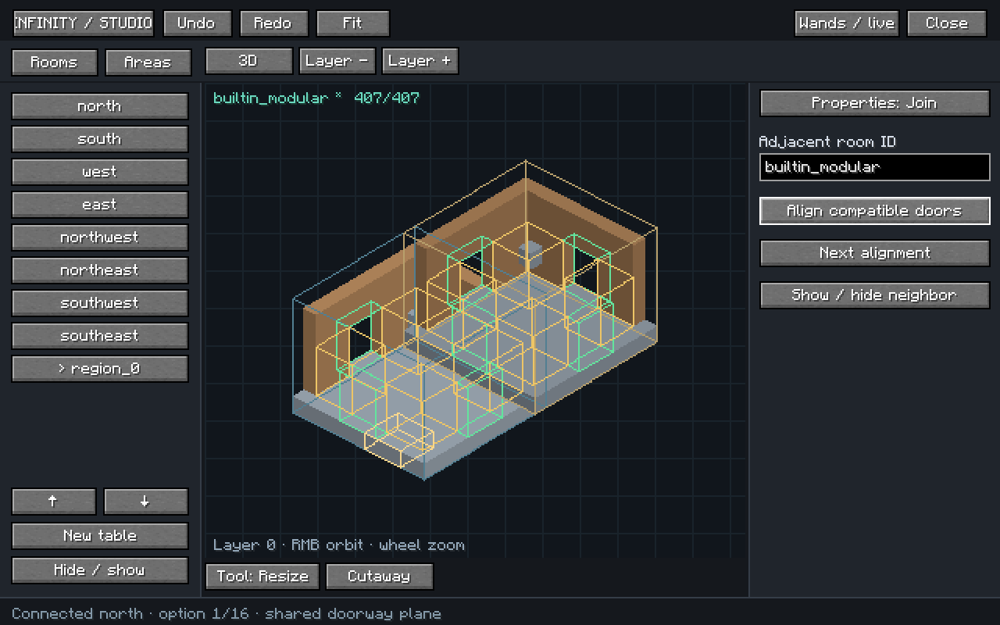
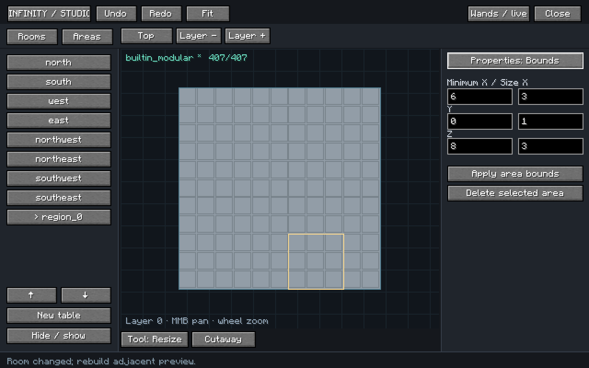

> **Archived 3.1 client companion.** Fabric work is shelved. Infinity Library 4.0 uses [vanilla builder menus and wands](BUILDER.md); no client mod is required.

# Infinity Library Studio 3.1

The optional Fabric 26.3 companion now opens a docked visual workspace with **B**. Its layout takes inspiration from 3D editors: a catalog/outliner on the left, a viewport in the center, and a properties inspector on the right. This is an independent Infinity Library tool; Axiom and Blender are not dependencies.

## Install

Update both `InfinityLibraryPlugin-3.1.0.jar` on your Paper 26.3 server and `InfinityLibraryBuilder-3.1.0.jar` in your Fabric 26.3 client. Java 25, Fabric Loader 0.20.1+, and compatible Fabric API are required. Keep your plugin data folder and world; no reset is required. Builders need `infinitylibrary.admin`. Normal readers do not need the companion.

## Open a visual draft

Choose a saved template under **Rooms**. Page buttons browse the complete catalog. A server-owned draft loads in bounded pages; the viewport shows loading progress. Opening another template asks before discarding unsaved work. Drafts and their eight-step undo/redo history are temporary and are cleared on disconnect, world change, server reload or shutdown. Save before leaving.

The viewport uses a colored voxel representation of stored base blocks, with colored bounds for doors (green), decorations (gold), Diversity targets (purple) and shelf/reading regions (blue). It does not simulate lighting, entities, block-entity contents or Minecraft's exact block shapes/textures. The 3D view caps drawing at 3,000 exposed voxels for responsiveness; use slices to inspect larger structures. For actual Minecraft blocks, rendered decorations and Diversity alternatives, use **Wands / live** and the existing live-preview tools.

## Viewport controls

- Cycle **3D / Top / Front / Side** at the top of the viewport.
- In 3D: right-drag to orbit and middle-drag to pan. Scroll to zoom. **Fit** frames the current room and its adjacent preview.
- In slices: middle-drag to pan, scroll to zoom, and **Layer − / +** to choose the perpendicular slice. Top uses Y layers, Front uses Z, Side uses X.
- **Cutaway / Full shell** toggles removal of the roof and facing walls in 3D.
- The bottom **Tool** button cycles Select, Move, Resize, Paint and Erase.

## Edit areas visually

Choose **Areas** to see the room's existing editable regions. Select one from the outliner or by clicking its bounds in the viewport. Smaller overlapping projected bounds take priority; the outliner provides unambiguous selection. Hide/show affects viewport outlines only.

In a slice, drag to define a selection box. With an existing area selected, **Move** drags its position and **Resize** drags its size in that plane. The completed drag sends one validated operation and can be undone with Studio Undo. Use **Properties: Bounds** for exact minimum X/Y/Z and size X/Y/Z, then **Apply area bounds**.

**New** starts a new area from the current selection. Cycle the inspector heading to **Rules**, choose the kind and ID, set its category/door direction/floor or decoration options, and apply. The inspector scrolls with the mouse wheel when controls extend below the window. All six supported kinds are available: connection, decoration, Diversity, shelf, table and seat.

Doors must face outward at a room boundary and preserve full matching dimensions. Decoration areas retain the existing interior, overlap, clearance and exact/PACKED/category rules. Moving Diversity targets preserves their captured variants; resizing a target with captured variants is rejected so source blocks are not silently stretched or cropped. Use the existing wands to capture new Diversity sources and variant-specific doors. Legacy random-variation captures are preserved; their source blocks are managed with those existing tools.

**Delete selected area** asks for confirmation. The final required connection cannot be removed unless the template still has valid variant connections.

## Edit room blocks

Use a Top/Front/Side slice and choose Paint or Erase. Dragging applies a rectangular brush on that slice. **Properties: Brush** selects a Minecraft block state (for example `minecraft:oak_planks`) or fills/erases the entire current selection box. Each operation is limited to 4,096 cells. Undo/redo restores complete draft snapshots.

These operations edit the saved-room draft, not terrain or already placed room instances. Room dimensions are fixed by the source template; capture a differently sized build with the Room wand when needed. Existing room-type validation stays active, including required reading/shelf contents.

## Live adjacent-room preview

Cycle the inspector to **Join**, enter the adjacent template ID, and press **Align compatible doors**. Selecting a connection area first uses that particular door; otherwise the first base connection is used. The server tries rotations/reflections and compatible doors with matching width, height and floor index, rejects overlapping volumes, and positions the second room on the same doorway plane as the first. **Next alignment** cycles valid alternatives. Both rooms appear together in the viewport; Fit frames the pair.

After a draft edit, the server recomputes the selected neighbor alignment automatically. If it becomes incompatible, the neighbor is removed and the status explains why. This is a structural preview of two base templates, not a promise that terrain or every nearby exit permits that placement in a live generated library. Saved variant-specific topology and random decorations remain supported by the generator and existing live preview.

## Save safely

Cycle to **Save**, enter a custom ID, choose the room type and confirm **Save template**. Built-in templates and already placed template IDs remain protected; save an edited copy under a new name. Concurrent changes to an existing target template are rejected using its saved version. Saving a STARTING template does not move the existing entrance or select it automatically; use the existing start-room command when appropriate.

The server validates permissions, session token, sequence, world, authoring revision and draft revision. Invalid edits retain the last valid draft. Packet/model chunks are bounded and tagged so stale transfers cannot replace a newer model. Existing wand authoring, Book & Quill writing, shelves, community features and generation behavior remain available.
